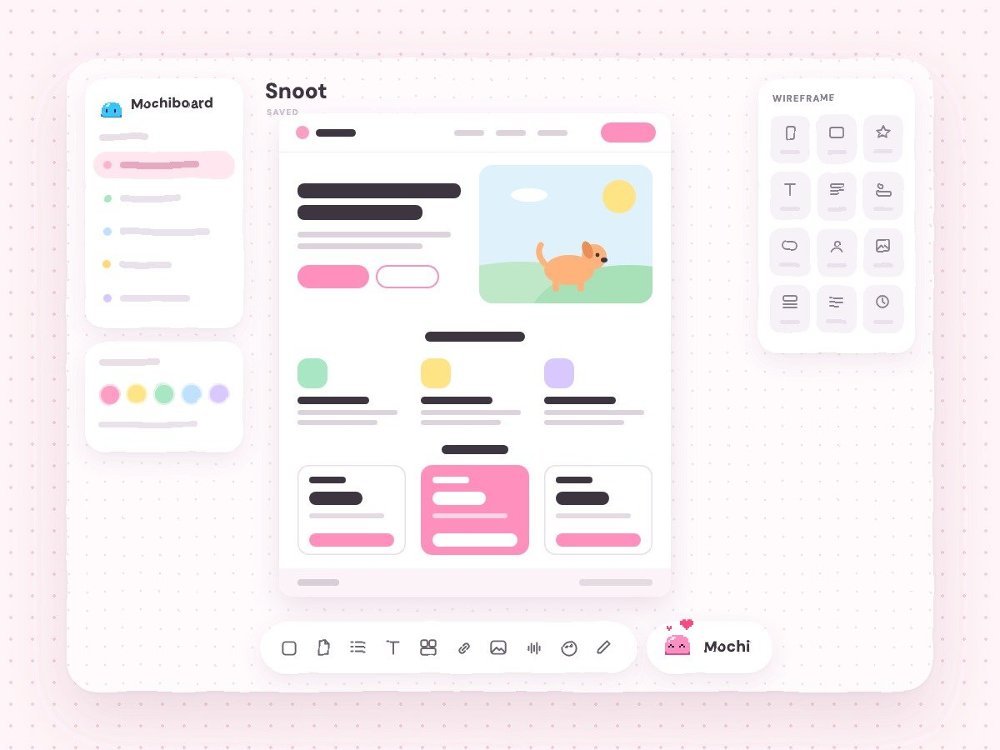

<p align="center"></p>

<h1 align="center">Mochiboard for Linux</h1>
<p align="center"><b>A cozy planning canvas with Mochi inside, for Linux and Wayland.</b><br>
A Linux port of <a href="https://github.com/jessawolfe-ux/mochiboard">Mochiboard</a> by <a href="https://jessa.art">Jessa Wolfe</a>, made for Arch / CachyOS, and at home on Hyprland, KDE Plasma, GNOME, Sway and niri.</p>
<p align="center"></p>

---

Mochiboard is a free, open-source app for the messy part before you open your design tools. Drop notes, pictures, links, checklists and colors on an endless board, arrange them however makes sense to *you*, and ask Mochi (a tiny pixel goo who thinks with Claude Code) to sort, plan, explore and build.

## What's inside

**The canvas**
- 🗺️ Infinite board. Pan with two fingers, pinch to zoom, cards tilt a little like real paper (or sit straight, your call).
- 🗒️ Notes, titles, checklists, docs, collections, links, images (with crop), voice memos that write themselves out, videos, colors that name themselves, shapes, stamps, drawing, and curvy connectors.
- 🧠 ADHD-friendly: **Ctrl+K** drops an idea into **Unsorted** without losing your place, and **F** focuses on just what you're working on.
- 📐 Wireframes: screens, boxes, text (with your computer's fonts), Material icons, ready-made pieces (nav bars, tab bars, inputs, cards…) and whole website sections. Things snap into line as you move them.
- 🗂️ Projects, folders and boards, with a home page for all of them. Right-click anything to rename, move, duplicate or delete.
- 🌙 Light and dark mode, undo (Ctrl+Z), and export any card or board as an image or PDF. Docs download as PDF or Word.

**Mochi**
- 🫧 Chat with her about your board. She can add, edit, sort and connect cards, make collections and folders, and always suggests a few things to do next.
- 🔤 Ask her to explore fonts and she puts real type specimens on the board, from your computer or Google Fonts.
- 📱 Describe a flow and she builds real wireframe screens. Ask for a landing page and she builds a full page in your colors and fonts.
- ✨ She takes you right to whatever she made, and it glows for a second.

**Mochi's helpers (optional)**, using the connections in your Claude account:
- **Mobbin** for real app screens as inspiration.
- **Higgsfield** to fill image spots with real pictures. It costs credits, so Mochi always shows the price and your balance first and waits for your yes. That check can't be turned off.
- No Higgsfield? Mochi can draw simple illustrations for free, or leave the spots as labeled placeholders.

## Install

### From the code (recommended on Arch / CachyOS)

```bash
git clone https://github.com/chiangs/linux-mochiboard.git
cd linux-mochiboard
./install.sh
```

The installer:
1. Uses Arch's `electron` package for the window (it offers to `sudo pacman -S electron` if it's missing). On other distros, or if you say no, it downloads a private copy of Electron instead.
2. Puts Mochiboard in `~/.local/lib/mochiboard`, the `mochiboard` command in `~/.local/bin`, and an entry in your app launcher.
3. Opens it. The first time, Mochi walks you through setup and a short tour.

After that, Mochiboard checks for new versions on its own. When one is ready, a little dot shows on the ⚙ and Settings lists what's new, with an **Update now** button (it pulls from GitHub, reinstalls and reopens; your boards are never touched). From a terminal: `./install.sh --update`.

Installer options: `--update` (pull first), `--yes` (no questions), `--no-open`.

### AppImage

**[⬇ Download the latest AppImage](https://github.com/chiangs/linux-mochiboard/releases/latest)** (`Mochiboard-x86_64.AppImage`)

```bash
chmod +x Mochiboard-x86_64.AppImage
./Mochiboard-x86_64.AppImage
```

AppImages need FUSE 2 (`sudo pacman -S fuse2` on Arch). The AppImage updates itself from GitHub Releases: say yes once and new versions slip in when you quit. To add it to your app launcher, use [Gear Lever](https://flathub.org/apps/it.mijorus.gearlever) or AppImageLauncher, or keep it in `~/Applications`.

### Uninstall

```bash
./uninstall.sh            # removes the app, then asks before touching your boards
./uninstall.sh --purge    # also deletes your boards and settings
```

It removes everything `install.sh` added (and any `~/Applications/Mochiboard*.AppImage`). Electron from pacman stays, since other apps may use it: `sudo pacman -Rs electron`.

## Connect Claude Code

Mochi thinks with [Claude Code](https://docs.claude.com/en/docs/claude-code) on your computer. Without it the whole canvas still works; Mochi just can't do the AI parts.

1. Install it: `curl -fsSL https://claude.ai/install.sh | bash` (or see the [setup guide](https://docs.claude.com/en/docs/claude-code/setup)).
2. Run `claude` once in a terminal and sign in with your Claude account.
3. Back in Mochiboard, open the ⚙ → **Helpers**. Claude Code shows **ready** as soon as Mochiboard finds it (no restart needed).

Mochiboard looks for `claude` in `~/.local/bin`, `~/.claude/local`, `/usr/bin`, `/usr/local/bin`, npm / nvm / volta / bun folders, and finally asks your login shell (bash, zsh or fish).

**Hooks.** Mochi's requests run with your Claude Code hooks switched off, so hooks meant for your own sessions (for example the [desktop Mochi](https://github.com/chiangs/linux-mochi)'s thinking meter and reply bubbles) don't fire while she thinks in Mochiboard. Skills, plugins, connectors and your login work as usual. To let your hooks see her requests, turn on **Settings → Helpers → Let my Claude Code hooks see Mochi's requests**.

**Mobbin and Higgsfield** are connectors in your Claude account: add them at [claude.ai/settings/connectors](https://claude.ai/settings/connectors). Mochiboard sees them through `claude mcp list`.

## Voice memos written out (optional)

On the Mac, Apple's speech recognition writes out voice memos. On Linux, Mochiboard uses [whisper.cpp](https://github.com/ggml-org/whisper.cpp), which runs on your computer:

```bash
yay -S whisper.cpp      # or build it yourself; Mochiboard looks for whisper-cli
```

The first memo downloads the speech model (about 140 MB, once) into `~/.local/share/mochiboard/whisper`. To use a different size, set `MB_WHISPER_SIZE=tiny|base|small|medium`, or point `MB_WHISPER_MODEL` at a model file you already have. Without whisper.cpp, memos still record and play.

## Your stuff

- Boards are plain files in `~/.local/share/mochiboard` (same layout as the Mac app, so you can copy boards over from `~/Library/Application Support/Mochiboard/boards`). No account, no cloud.
- App settings (your name, theme, the tour) live in `~/.config/Mochiboard`.
- Mochi only thinks when you ask her something. Then the board and your question go to Claude Code on your computer, the same as asking Claude yourself.
- Switch Mochi's thinking off in Settings and the whole canvas still works, with no AI and no internet.
- Chats are kept the way you choose: on each board, until you quit, or not at all.

## Shortcuts

| | |
|---|---|
| **Ctrl+K** | Quick capture into Unsorted |
| **double-click** | New note |
| **N · C · T · D · G** | Note, checklist, title, doc, collection |
| **L · I · A · V** | Link, image, voice memo, video |
| **S · E · P** | Shapes, stamps, draw |
| **R · X** | Wireframe box, wireframe text |
| **M** | Ask Mochi |
| **F** | Focus on the selection |
| **0** | Fit the whole board |
| **Ctrl+Z / Ctrl+Shift+Z** | Undo / redo |
| **Ctrl+G / Ctrl+Shift+G** | Group / ungroup, so things move together |
| **Ctrl+C / Ctrl+X / Ctrl+V** | Copy, cut and paste cards, even onto another board |
| **Ctrl+\\** | Just the board (hide the panels) |
| **space + drag** | Pan |
| **Ctrl+M · Ctrl+Q · F11** | Minimize · quit · full screen |

## The window

Like on the Mac, Mochiboard has no title bar: the board fills the window. The three dots at the top left close, minimize and maximize it, and the strip next to them drags it. Resize from any edge. On tiling compositors (Hyprland, Sway, niri) the compositor places it like any other window.

## Troubleshooting

- **Blank or flickering window on NVIDIA.** Put extra Electron flags in `~/.config/mochiboard-flags.conf`, one per line, e.g. `--disable-gpu-compositing` or `--ozone-platform=x11`.
- **Force Wayland or X11.** The launcher passes `--ozone-platform-hint=auto` (Wayland when available). Add `--ozone-platform=wayland` or `--ozone-platform=x11` to the flags file to choose.
- **Camera or microphone not found.** Mochiboard uses the same camera and microphone as your browser (PipeWire). Check `pavucontrol` or your sound settings, and that nothing else holds the camera.
- **Mochi says she needs Claude Code** even though it's installed: run `which claude` in a terminal and make sure that folder is one of the places listed above, or symlink it into `~/.local/bin`.
- **Developer tools:** F12 or Ctrl+Shift+I.

## How it's built

Two layers:

- `web/`: the canvas, plain HTML, CSS and JavaScript with no build step. It's the same canvas as the Mac app.
- `linux/`: a small Electron host that does what a web page can't. It saves boards, fetches link previews, exports images and PDFs, writes out voice memos, and runs `claude -p` so Mochi can think.

The two talk through one channel (`window.webkit.messageHandlers.mb`, the same as the Mac app), so the canvas doesn't know or care which computer it's on. See [CONTRIBUTING.md](CONTRIBUTING.md) to change or extend it.

To work on the canvas in a browser, run `python3 -m http.server` inside `web/` (Mochi is pretend there). To run the app from the code without installing: `npm install && npm start`.

Icons are [Material Icons](https://fonts.google.com/icons) (Apache 2.0). Fonts are DM Sans and Caveat (OFL).

---

<p align="center">Mochiboard was made with 🫧 by <a href="https://jessa.art">Jessa Wolfe</a>. Linux port by <a href="https://github.com/chiangs">chiangs</a>. MIT licensed.</p>
